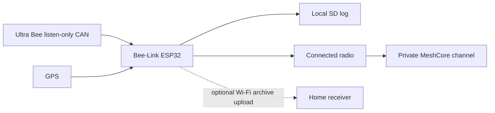
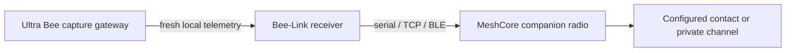

# Optional MeshCore telemetry

An experimental companion-radio bridge for **Surron Ultra Bee only**. It sends a small text summary of fresh battery state, speed and optionally GPS. It does not control the bike, replace its T-box, or implement MeshCore firmware on the ESP32.

## Intended bike installation — clarified 13 October 2026

The owner intends the **on-bike Bee-Link ESP32 to have a connected MeshCore-compatible radio**, publishing to **a private MeshCore channel**. A home receiver is not part of the intended radio path. The Python bridge below is an auxiliary prototype, not the implementation of that on-bike requirement.



The firmware must support user enable/disable and separate GPS opt-in, a default 15-minute interval with jitter, no catch-up backlog, and fresh verified readings. Local capture must continue if the mesh is unavailable or disabled. The dashboard's eventual on-bike controls must operate the ESP32 settings; the current Python receiver controls do not do that. Private channel configuration belongs on the transmitting device, with no channel secret in public source or telemetry messages. Coverage and recipient availability determine reception; this is not guaranteed tracking.

There are two materially different radio interfaces:

- **Separate MeshCore companion node:** the ESP32 talks to an MCU running MeshCore companion firmware through a supported companion transport. This avoids integrating the mesh stack into the CAN logger; exact wired serial framing, firmware build, voltage levels and pin support need validation.
- **Bare LoRa transceiver attached to the ESP32:** the Bee-Link firmware must integrate the MeshCore stack, supported radio driver and board configuration. A LoRa chip does not run MeshCore by itself. This requires coexistence testing with CAN, GPS and SD tasks, plus RAM, SPI/pin and power-budget checks.

The owner has now specified **XIAO ESP32S3 & Wio-SX1262 Kit plus Seeed's L76K GNSS module**. This is the bare-transceiver arrangement. The [embedded module](../../firmware/meshcore/README.md) provides an experimental native MeshCore overlay and USB controls. Its hardware notes identify a documented overlap between radio MOSI and GNSS reset that must be resolved before bring-up. Protected CAN capture, a verified SOC decoder, SD logging and browser controls of the on-bike module remain pending; the Python bridge below is separate.

## What works in this prototype

The local Bee-Link receiver has a background scheduler and dashboard controls under **Connection & setup → MeshCore**. The module is disabled on every receiver startup. Location sharing is separately disabled. Enabling schedules the first attempt after the selected interval, initially 15 minutes, plus 0–60 seconds of jitter. There is no immediate send, catch-up queue or application message retry. Intervals from 15 minutes to 24 hours are supported.

Each send uses only individually timestamped, `verified` signals captured within the previous 60 seconds. Future, missing, guessed and simulated readings are omitted. Coordinates require a coherent fresh pair and explicit location opt-in. If nothing qualifies, the attempt is skipped. The message is ASCII and limited to 120 bytes, for example:

```text
Bee-Link 12:00Z BAT 65% SPD 12.3km/h GPS 51.0000,-1.0000
```

The `verified` label comes from the capture producer or configured decoder; the bridge cannot establish that an unknown CAN mapping is correct. Bee-Link still ships an empty CAN profile. Do not label guessed mappings verified to make the feature send.

## Choose where the bridge runs



A receiver and USB radio at home can only send current bike telemetry while that telemetry reaches home. Uploading an old SD ride log does not provide a live tracker. For updates during a ride, the capture source, receiver host and companion radio must travel with the bike, or a separately designed live link must reach the receiver. Native on-bike ESP32 MeshCore integration remains future work. This prototype adds a bridge to the existing Python receiver.

## Install and configure

Use a MeshCore **companion** radio already configured through your normal MeshCore tools. The bridge does not set radio frequency, region, transmit power, channel keys or contacts. It opens one connection per attempt; another app using the same serial/BLE connection may need to disconnect first.

On the receiver host, using the same Python environment as Bee-Link:

```sh
python -m pip install -r requirements-meshcore.txt
```

The optional dependency is pinned to `meshcore==2.3.15`. The normal receiver does not require it. A Docker image can include it with `docker build --build-arg WITH_MESHCORE=true -t bee-link-meshcore .`; serial access additionally needs the chosen device passed into the container. BLE in containers requires host-specific Bluetooth configuration and is not validated here.

Configure one destination and connection in the receiver environment before starting it. Unix serial/direct-contact example:

```sh
export BEELINK_MESHCORE_TRANSPORT=serial
export BEELINK_MESHCORE_ADDRESS=/dev/ttyUSB0
export BEELINK_MESHCORE_CONTACT='<recipient full 64-character public key>'
python server.py
```

On Windows use `$env:BEELINK_MESHCORE_ADDRESS='COM5'` and the equivalent PowerShell environment assignments. Never put the placeholder public key into production configuration.

| Variable | Meaning |
| --- | --- |
| `BEELINK_MESHCORE_TRANSPORT` | `serial` (default), `tcp` or `ble` |
| `BEELINK_MESHCORE_ADDRESS` | Serial path/COM port, TCP host or BLE address |
| `BEELINK_MESHCORE_PORT` | TCP port, default 4000; match your companion configuration |
| `BEELINK_MESHCORE_CONTACT` | Exact full public key of an existing radio contact |
| `BEELINK_MESHCORE_CHANNEL` | Alternative channel index, supported configuration range 1–7 |
| `BEELINK_MESHCORE_PRIVATE_CHANNEL` | Must be `1` when using a channel, acknowledging operator configuration of a private channel |

Choose contact **or** channel, never both. Channel 0 is excluded. The private-channel acknowledgement cannot inspect or prove that the radio actually has a private key configured: check that in your MeshCore app. Channel slots vary with firmware; this bridge's 1–7 range is a conservative supported subset.

Connect the dashboard to the receiver, then enable the module and optionally location sharing. Save settings. The selected dashboard device ID identifies the source. Disabling cancels pending attempts; a message already handed to the radio cannot be recalled. Settings are held in memory and reset when the receiver restarts. Switching the dashboard to its demo does **not** disable an already enabled receiver module; use Disable while connected, or stop the receiver.

## Privacy and delivery

The destination is deliberately configured on the receiver, not discovered automatically. Location and telemetry reach that destination; private-channel members can read them. The module does not log message bodies or return recipient configuration in its status API. It does not send MeshCore position advertisements or accept incoming remote commands.

`submitted` means the companion accepted a send command. It does not prove recipient delivery. MeshCore routing and firmware behaviour may add radio traffic of their own; the application makes one submission per interval. Follow your normal local radio configuration and airtime constraints.

## Evidence and remaining checks

The adapter follows the [official MeshCore Python library](https://github.com/meshcore-dev/meshcore_py): companion connections via `create_serial`, `create_tcp`, `create_ble`; `send_msg` for a contact and `send_chan_msg` for a channel. It deliberately does not call `send_msg_with_retry`.

The formatter was developed using the user's Mac-hosted local model, then reviewed and integrated with the receiver. Automated checks use synthetic data and fake radio objects. No radio, over-air delivery, real Ultra Bee CAN mapping, BLE hardware, TCP companion or travelling receiver installation has been validated. Before relying on it, verify one chosen companion connection and private destination with non-location data, then verify capture timestamps and decoded fields against your bike.
