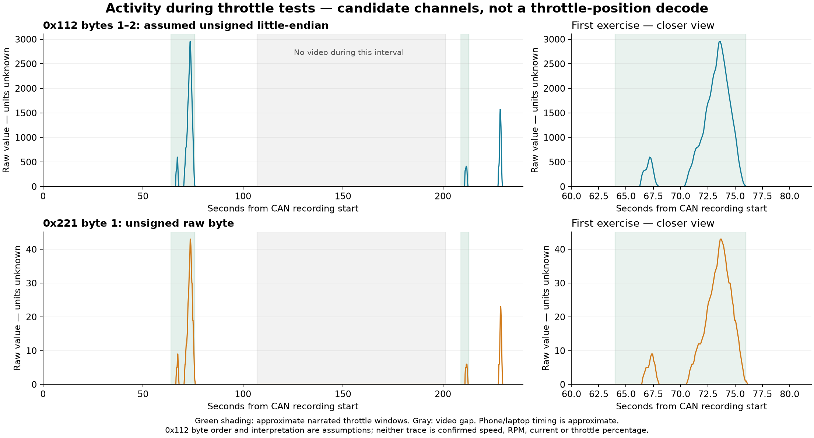

# Initial Ultra Bee CAN findings — 25 October 2026

> **Initial findings — not confirmed.** These are observational associations from one owner's Ultra Bee, not an OEM specification, validated decoder, installation guide or instruction to transmit. Values may differ across bikes and firmware revisions.

## Capture context and evidence limits

An owner-supplied CAN CSV was compared with two narrated video parts. The owner reports a connection at the T-box wiring. The exact bike year, market, T-box/controller revisions, connector orientation and pin assignments were not documented sufficiently for independent reproduction.

- Logger: DSD TECH SH-C31G; firmware v1.5 was verified separately before capture. The CSV itself says firmware “not reported”.
- Software: diCAN 1.0.0; export reports **500 kbit/s, classic CAN, Silent mode**.
- Dataset: **105,346 Rx records, 33 CAN IDs**, approximately four minutes. The export labels its scope FILTERED, with “no filter” listed throughout its filter history.
- Physical setup: owner reports R120 off, BOOT off, +5 V unconnected and no separate adapter GND connection. This documents the experiment; it is not a recommended wiring arrangement.
- Earlier session logs showed receive errors. Error rate and dropped frames for this recording are not established. Receiving frames does not validate signal integrity, electrical silence or connection safety.
- Audio was automatically transcribed locally. Spoken letters and word timings can be misrecognised. Narration may precede the action.
- Raw CSV and videos are retained privately and **not included here**. These tables are derived observations; public independent replay verification is not yet possible. Device identifiers, location metadata and identifying payloads have been omitted.

## Candidate signal table

**All IDs and payload values below are hexadecimal.** Payload positions are counted from **byte 1**; zero-based indexes are supplied to avoid ambiguity. All candidate frames in this table use **standard 11-bit identifiers and DLC 8**.

| CAN ID | Payload location | Observed hex value/change | Narrated association | Evidence and status |
| --- | --- | --- | --- | --- |
| `0x113` | Byte 6 (index 5) | `00` | E riding mode | Repeated returns to E across both video parts; **stronger candidate, unconfirmed** |
| `0x113` | Byte 6 (index 5) | `03` | D riding mode | Repeated D selections across both parts; **stronger candidate, unconfirmed** |
| `0x113` | Byte 6 (index 5) | `01` | S riding mode | S selections in both parts; **stronger candidate, unconfirmed** |
| `0x113` | Byte 6 (index 5) | `04` | Reverse selected | One narrated reverse episode, followed by return to `00`; other fields change too; **tentative** |
| `0x113` | Byte 2 (index 1) | `00 → 01` | Ready / drive-enabled state | Near ready announcements in both parts; exact interlock/state semantics unknown; **tentative** |
| `0x112` | Bytes 1–2 (indexes 0–1) | Varying raw bytes; baseline `00 00` | Throttle-related activity | Changes near throttle exercises; could represent speed, current or another correlated quantity; **unresolved** |
| `0x221` | Byte 1 (index 0) | Varies from baseline `00` | Throttle-related activity | Changes during the same exercises; **unresolved** |
| Not identified | Not identified | No assigned value | Left/right indicators, hazards, horn, high beam | No convincing mapping established in this comparison. **Not observed/decoded**, not proof of absence from CAN |

The mode candidates describe observed status; they are not commands. No bit mask has been validated for these fields. Byte order, signedness, scale, offset and engineering units for the varying multi-byte channels are unknown. No throttle percentage or speed/current calibration is claimed.

## Narrated mode sequence and observed transitions

Times are seconds from the CSV recording start. Video locations are approximate, derived from embedded creation times rather than a shared synchronization signal.

| CSV time (s) | Video part / approximate elapsed time | ID | Payload byte | Hex value | Narrated association |
| --- | --- | --- | --- | --- | --- |
| 41.629 | Part 1 / 00:57.27 | `0x113` | 2 | `01` | Ready announcement |
| 49.406 | Part 1 / 01:05.05 | `0x113` | 6 | `03` | D |
| 52.133 | Part 1 / 01:07.77 | `0x113` | 6 | `00` | E |
| 53.648 | Part 1 / 01:09.29 | `0x113` | 6 | `01` | S |
| 55.567 | Part 1 / 01:11.21 | `0x113` | 6 | `00` | E |
| 57.184 | Part 1 / 01:12.83 | `0x113` | 6 | `03` | D |
| 59.001 | Part 1 / 01:14.64 | `0x113` | 6 | `00` | E |
| 94.148 | Part 1 / 01:49.79 | `0x113` | 6 | `04` | Reverse candidate |
| 96.876 | Part 1 / 01:52.52 | `0x113` | 6 | `00` | Return from reverse candidate |
| 205.613 | Part 2 / 00:04.25 | `0x113` | 2 | `01` | Ready announcement |
| 215.613 | Part 2 / 00:14.25 | `0x113` | 6 | `03` | D |
| 217.733 | Part 2 / 00:16.37 | `0x113` | 6 | `00` | E |
| 218.945 | Part 2 / 00:17.59 | `0x113` | 6 | `01` | S |
| 220.763 | Part 2 / 00:19.40 | `0x113` | 6 | `00` | Return state consistent with E; narration less clear |

One reverse-associated sequence illustrates why assigning only one field is incomplete:

| CSV time (s) | Full `0x113` payload |
| --- | --- |
| 94.148478 | `00 01 02 00 00 04 00 00` |
| 94.250214 | `00 01 01 00 00 04 00 00` |
| 96.876007 | `01 01 00 00 00 00 00 00` |

Interpretations of bytes 1 and 3 in this sequence remain open.

## Raw activity during throttle tests

The left panels show the recording as a whole; the right panels enlarge the first exercise. Green shading marks approximate narrated throttle windows, and gray marks the interval without video. Axes show raw numeric values, **not throttle percentage, mph, km/h, RPM or amperes**.

| Candidate | Plot interpretation | Observed range | Largest peak |
| --- | --- | --- | --- |
| `0x112`, bytes 1–2 | Assumed unsigned 16-bit little-endian: byte 1 + 256 × byte 2 | 0–2,958 | CSV 73.636 s |
| `0x221`, byte 1 | Unsigned raw byte | 0–43 | CSV 73.644 s |

Both traces show a small pulse around CSV 66–68 s, then a larger rise and return to zero around 70–76 s. Activity also appears around 211–213 s and 228–230 s. The later episode's precise narrated association remains unresolved.

**Was speed captured? Possibly, but no signal is confirmed as speed.** The similar shapes make these useful candidates for related measurements or differently scaled representations. They could reflect motor/wheel speed, throttle demand, current or another correlated quantity. Byte order and field interpretation for `0x112` are plotting assumptions, not validated definitions. The observed peaks are not evidence of 43 mph or 2,958 RPM.

The rear-wheel motion and independently displayed speed were not established in this analysis. Establish those references before assigning a physical quantity or units. These plots do not reconstruct the rider's hand position and do not resolve earlier electrical/error concerns.

## Timing limitations

The approximate relationship is:

- Part 1: CSV seconds ≈ video seconds − 15.642.
- Part 2: CSV seconds ≈ video seconds + 201.358.

These assume the phone and laptop clocks agree. Embedded creation times have one-second precision, CSV timestamps are host-side, and narration/action offsets vary. Decimal places locate the original records; they do not imply sub-second synchronization accuracy.

Part 1 lasts 122.795 seconds and part 2 lasts 30.050 seconds. There is approximately **94.2 seconds without video** between them. CAN changes in that interval have no narrated association and must remain unassigned.

## What would confirm or reject these candidates?

1. Document bike/electronics revisions, connector viewing direction and the reviewed electrical setup, with identifiers redacted.
2. Repeat stationary E → D → E → S → E selections, holding each displayed mode for ten seconds and filming the display clearly.
3. Test ready/not-ready separately from mode selection, including normal interlocks without bypassing them.
4. Repeat reverse selection separately; distinguish selection status from motion.
5. Separate throttle demand from motor/wheel speed and current using independent references before assigning units.
6. Run a dedicated lighting-control capture if needed; absence of a decoded match is not evidence that no message exists.
7. Assess receive errors and prepare redacted replay evidence before promoting definitions into a supported decoder.

Keep subsequent capture work listen-only. No mapping here is admitted as **Bee-Link verified**, and no cross-variant compatibility is claimed.

[Back to the research register](../research.md)
