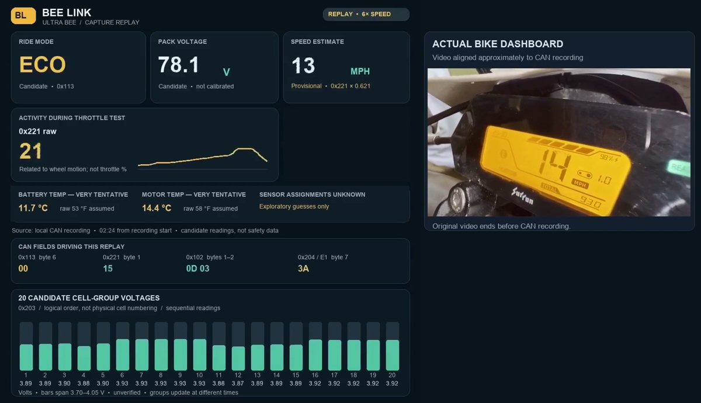

# Ultra Bee dashboard and CAN replay

A milestone from our first narrated Ultra Bee CAN capture: the bike's dashboard alongside a replay of candidate CAN data, including 20 possible battery cell-group voltages.

**[Download the dashboard and CAN replay (MP4)](https://github.com/treveansalt/project-bee-link/raw/refs/heads/main/docs/findings/images/2026-11-06-dashboard-cell-replay.mp4)**

The silent, 49-second video runs at six times the recording speed. Its dashboard footage and CAN data are approximately aligned. The cell-group values, speed and mode interpretations remain provisional. Battery and motor temperature labels and the Fahrenheit conversion are exploratory guesses; neither sensor identity has been established.

Read the [capture findings and limitations](2026-11-06-can-replay-findings.md) for the evidence behind the replay.
