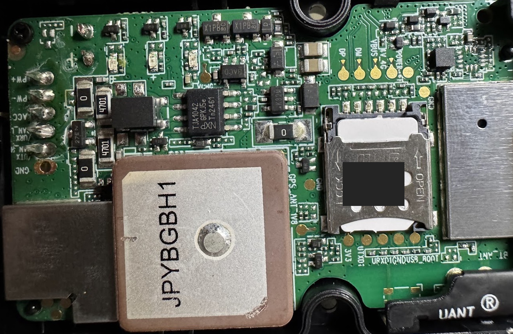
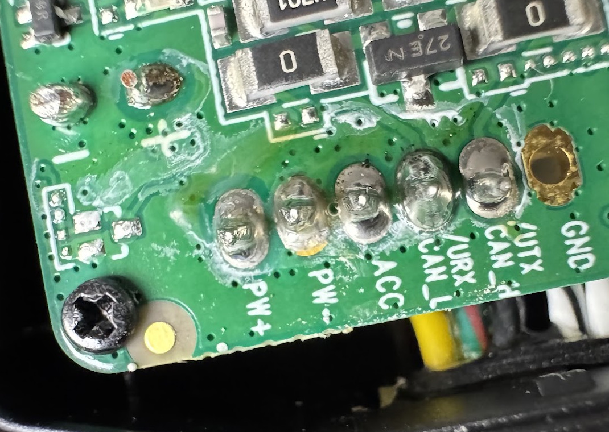
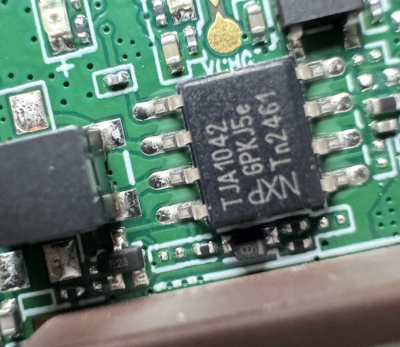
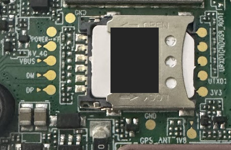
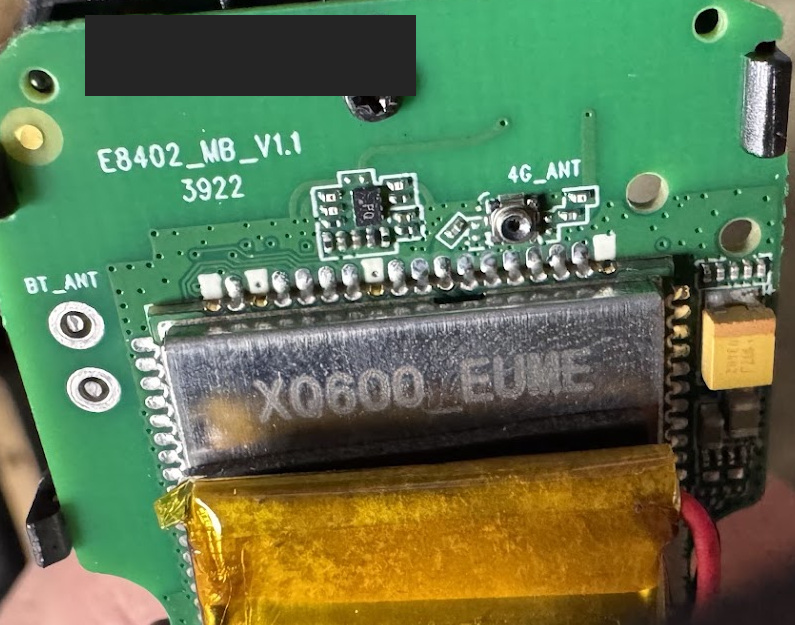
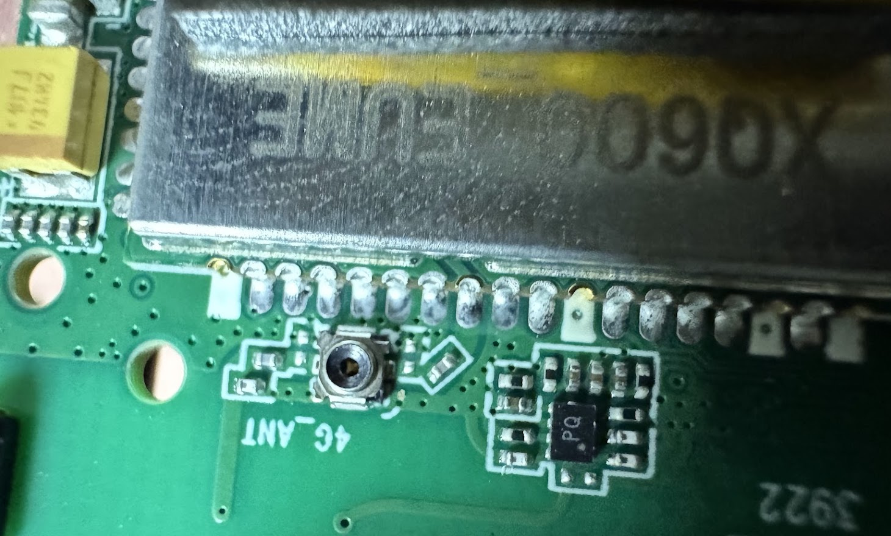
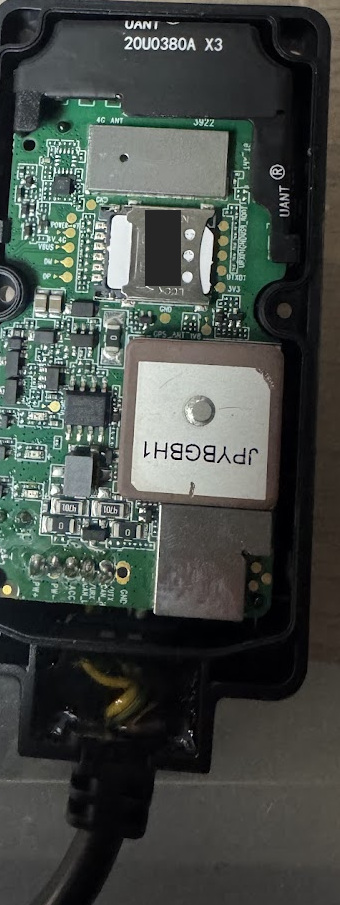

# Ultra Bee T-box: E8402_MB_V1.1

[Hardware reference index](../README.md) | [Printable workshop guide](../../guides/README.md)

Owner-supplied photographs of an opened Surron Ultra Bee T-box, documented **21 October 2026**. This is a record of one physical board, not a manufacturer schematic or a validated connection procedure.

**Main finding:** the board has visibly labelled `CAN_H` / `CAN_L` harness pads and an NXP `TJA1042` CAN transceiver. This gives a specimen-specific starting point for tracing the external connector. No continuity measurements, supply measurements, connector cavity mapping, bitrate or decoded CAN signals have yet been recorded for this specimen.

## Evidence and specimen identity

| Item | Observation | Limit |
| --- | --- | --- |
| Vehicle | Owner identifies it as an Ultra Bee | Model year, market and controller/battery revisions not supplied here |
| PCB identifier | `E8402_MB_V1.1` | Visible in reverse-side photo; not the enclosure's product model |
| Additional PCB marking | `3922` | Meaning not established; do not infer a production date |
| External module model | Not established by this photo set | Do not assume QL-TBOX-JM solely from internal similarity |
| Enclosure | Long plastic enclosure, wired cable entry, internal antennas and SIM holder | External connector face and cavity numbers not shown |
| Inspection | Visual only | No powered tests or firmware extraction performed |

The photographs were supplied by the project owner for documentation. Crops preserve their original orientation; no component details have been generated or reconstructed. The SIM identifier and an unclassified handwritten unit marking are obscured, and embedded photo metadata is not copied. See the [photo manifest](photos/manifest.json) for source-photo numbers, crop/redaction coordinates and hashes. Originals remain outside the published repository.

## Board overview

*Source photo 1. This view is sideways relative to the assembly view below. Use the labels, not left/right positions from a different photograph.*

## Harness pads: what the board actually labels

*Source photo 5. The order below applies only to this crop as displayed. These are not external connector pin numbers.*

| Left-to-right joint in this image | Visible label | Interpretation and confidence |
| --- | --- | --- |
| 1 | `PW+` | Label indicates positive power input; actual voltage not measured |
| 2 | `PW-` | Label indicates power return; relationship to other ground points not measured |
| 3 | `ACC` | Likely ignition/accessory sense, consistent with the T-box reference manual; voltage and behaviour not measured |
| 4 | `URX` / `CAN_L` | Dual-labelled harness connection; candidate external CAN-L, to confirm by tracing |
| 5 | `UTX` / `CAN_H` | Dual-labelled harness connection; candidate external CAN-H, to confirm by tracing |

There is also an adjacent plated hole labelled **`GND`**, separate from the five solder joints. Its relationship to `PW-` and the adapter's required reference should be measured before connection. The dual UART/CAN labels do not establish a software-selectable UART mode or make these wires suitable for a USB-UART adapter.

**Wire colours are not assigned from these photographs.** Wires pass behind the PCB, and colour-to-joint continuity cannot be followed reliably. The generic manual's external pin table remains a separate reference; the five joints and nearby GND hole are not a six-pin connector drawing.

## CAN transceiver

*Source photo 6. `TJA1042` and the NXP logo are legible. Additional short markings are retained in the photograph but are not treated as a complete ordering code.*

The [NXP TJA1042 datasheet](https://www.nxp.com/docs/en/data-sheet/TJA1042.pdf), especially sections 6 and 7, identifies this family as a high-speed CAN physical-layer transceiver. It connects a controller's logic signals to the two-wire CAN bus. It is **not** the main application processor, a GPS receiver or proof of a particular CAN message format.

For the datasheet's SO8 packages, the bus pins are **6 = CANL** and **7 = CANH**, with **2 = GND**. Those are IC pin numbers, not board-joint positions or harness cavity numbers. Correct package orientation and the board's intervening circuitry must be established before using them for tracing; do not identify legs by screen position alone.

Two important limits:

- Pin 5 is variant-dependent: SPLIT on some versions, VIO on others. Do not infer logic voltage or connect an ESP32 to a chip leg from the family name alone.
- The TJA1042 has Normal and Standby modes. Standby provides wake-up detection; it is not a general full-rate silent capture mode. Passive capture requires a suitable adapter/controller configuration. Nothing in these photos proves that the OEM T-box never transmits.

Neither this marking nor a transceiver's maximum supported rate establishes the Ultra Bee's bitrate, Classical CAN versus CAN FD use, identifiers, scaling or topology.

## Other components and functional areas

| Visible item | What can reasonably be said | What remains unknown |
| --- | --- | --- |
| Square ceramic patch, marked `JPYBGBH1` | Appearance and nearby `GPS_ANT` silkscreen are consistent with a GNSS antenna | Antenna specification, supported constellations, receiver identity and output protocol |
| Hinged metal SIM holder | Consistent with the T-box's cellular role; not a microSD logger slot | SIM provisioning, network access and modem configuration |
| Shielded/module area and `4G_ANT` marking | Strong evidence of cellular-radio circuitry; RF connector visible on reverse | Exact modem/processor part, supported bands, pinout and firmware |
| `BT_ANT` marking | Board includes an area labelled for a Bluetooth antenna | Bluetooth version, enabled services and pairing/protocol behaviour |
| Internal foil-pouch battery | Visible behind the board, with wiring and insulating tape | Chemistry, capacity, charge circuit and remaining runtime; do not infer from appearance |
| Three small light-emitting packages with nearby polarity marks | Likely status LEDs | Which LED corresponds to which software state on this revision |
| Components marked `0` and `4701` | Markings are consistent with zero-ohm links and 4.7-kilohm resistors respectively | Circuit role, tolerance, values verified by measurement and topology |
| Larger black packages, small ICs and protection/power area | Discrete and power-related circuitry is present near the input | Exact identities, regulator outputs, protection ratings and circuit completeness |
| `3V3`, `VBUS`, `DP`/`DM`, `POWER`, UART-style and `USB_BOOT` service labels | Useful leads for later interface tracing | Actual voltages, USB implementation, console baud rate, boot behaviour and access protection |

No ESP32 has been identified on this OEM board. Shield printing and short component codes are insufficient to identify the main processor. The `3V3` label is not permission to apply 3.3 V: it may be an output or connect to a rail that must not be back-powered.

### Service pads and SIM holder

*Source photo 4. Labels can guide tracing, but this photograph is not a programming/debug connector pinout. No firmware readout method is established.*

### Reverse-side board identifier, radio area and backup battery

*Source photo 7. A handwritten unit marking is concealed. The internal battery means disconnecting the bike harness alone does not establish that the board is unpowered.*

### Radio-area detail

*Source photo 8. Printing on the shield is only partly legible; an exact radio/module identification is deliberately left open.*

### Assembly and cable entry

*Source photo 3. This includes context for locating the labelled end of the board and the internal antennas. It does not show the external plug face.*

## How this relates to earlier research

The [manufacturer QL-TBOX-JM manual](https://device.report/m/0805101ae6f36a81e5dd0b39d12f594e8d1152e780c3ee6ed9882b4534274154) describes a T-box with CAN, GNSS, cellular, Bluetooth, power and ACC functions. The architecture visible here is consistent with those general functions, but **the actual enclosure model/revision must still be checked** before adopting its pin table or operating details.

The [FCC filing](https://fccid.io/2A92B-QL-TBOX-JM) and [existing research notes](../../research.md) are background sources. A similar enclosure or PCB layout does not prove identical firmware, wiring or regional hardware. These owner photographs improve the evidence for this specimen's labels and component family; they do not validate a universal T-box replacement.

## Next measurements and capture record

1. Record the enclosure's product model and the bike's year/market, with identifiers redacted before sharing.
2. Photograph both sides of the external connector with the latch and moulded cavity numbers visible.
3. Before resistance or continuity testing, disconnect the bike and internal battery using a safe procedure, and confirm zero voltage. Do not cut battery wrapping or bridge pads. If the battery cannot be safely isolated, defer unpowered measurements.
4. Trace each labelled harness joint to its external cavity. Record resistance, not only a continuity beep; filters/protection components can affect readings.
5. Confirm the relationship between `PW-`, labelled `GND` points and the CAN interface's reference requirements. An isolated adapter's bus-side reference is different from its USB-side ground.
6. Establish bus voltage, termination and bitrate with the OEM topology preserved. Only measure resistance with all bus power removed; key-off can leave modules awake.
7. Use a verified listen-only capture setup, with no extra termination added to an already terminated bus. Preserve raw timestamps, identifiers, frame flags and payloads before attempting decoding.

| Measurement | Result |
| --- | --- |
| External model / enclosure revision | Not recorded |
| CAN-H external cavity / wire colour | Not measured |
| CAN-L external cavity / wire colour | Not measured |
| `PW-` to labelled `GND` relationship | Not measured |
| Supply and ACC voltages | Not measured |
| H-to-L resistance and connector state | Not measured |
| Confirmed bitrate / frame format | Not measured |
| Adapter model, isolation and reference connection | DSG Tech SH-C31G reported by owner; documentation and configuration not verified here |
| First raw capture and acquisition conditions | Not recorded |

The owner is willing to solder a temporary tap. That is an experimental choice, not a recommended installation method or an electrically validated pad assignment. Any temporary wires need insulation and strain relief; CAN-H/CAN-L go to a CAN interface, not directly to ESP32 GPIO. Do not connect `PW+` or `ACC` to an adapter's data or ground terminal.

## Sources and evidence limits

- Owner photographs 1-8 supplied in this conversation; selected crops are published above with a [processing manifest](photos/manifest.json). Source photo 2 is omitted because the selected harness and transceiver close-ups are clearer; the other selected views supply complementary context.
- [NXP TJA1042 product page](https://www.nxp.com/products/TJA1042) and [datasheet, Rev. 11](https://www.nxp.com/docs/en/data-sheet/TJA1042.pdf): component functions, pin definitions and operating modes. These do not specify this assembled board.
- [Surron QL-TBOX-JM manufacturer manual](https://device.report/m/0805101ae6f36a81e5dd0b39d12f594e8d1152e780c3ee6ed9882b4534274154): comparative module architecture only until identity is confirmed.

No firmware dump, credentials, complete SIM identifier, serial console output or live bike/location data is included. Component hypotheses remain hypotheses until supported by readable markings, tracing, documentation or measurements.
